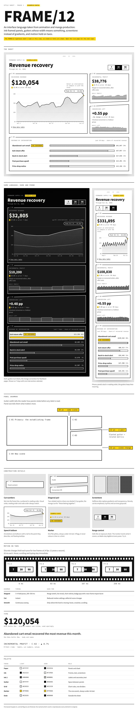

# FRAME/12

An interface design language taken from animation and manga production: ink-framed panels, gutters whose width means something, screentone instead of gradients, and motion held on twos.

**Status: Phase 1.** This repository holds the experiment that decides whether FRAME/12 is worth building into a system. It is not a component library yet, on purpose.



> Images in `docs/images` were rendered offline with stand-in fonts. The live pages load the real typefaces from Google Fonts.

## What's here

Three self-contained pages, built from one React codebase and one seeded dataset, so every number matches everywhere.

| Page | For | What it does |
| --- | --- | --- |
| `dist/prototype.html` | You and the designer critique | One recovery dashboard in a strong conventional style and in FRAME/12. Switch design, motion (smooth, stepped, cut), theme, and a grayscale test. |
| `dist/study.html` | Participants | Blind, counterbalanced study: 3 timed tasks per design, 6 ratings each, a side-by-side comparison, 3 stepped-vs-smooth motion pairs. Add `#results` to the URL for the live decision. |
| `dist/style-sheet.html` | Anyone | The visual language on one page: the sheet in light, dark and phone, panel grammar, construction details, motion, type and palette. |

All data is fictional (Fernwood Supply Co., 180 days ending Oct 31, 2026) and labelled "Example data" on screen.

## Quick start

```bash
npm install
npx playwright install chromium   # first time only, for the tests
npm run build                     # writes dist/*.html
open dist/style-sheet.html
```

The pages load React 18 from cdnjs and fonts from Google Fonts at view time. Everything else is inlined, so each file can be opened directly or published as a single page.

## Tests

| Command | Checks |
| --- | --- |
| `npm run test:study` | Walks the whole study on desktop and phone, decodes the result codes, imports them into the results view, and confirms scoring, design mapping and the decision rule. |
| `npm run test:a11y` | Text contrast against rendered backgrounds (WCAG AA), accessible names, unique ids, visible keyboard focus, stepped-motion pose count, reduced-motion behaviour. |
| `npm run test:screens` | Full-page screenshots of every page at 1280 and 390 px, light and dark, into `test-results/`; fails on sideways scroll. |
| `npm test` | Build, then study and accessibility checks. |

Offline runs: set `F12_REACT_UMD` to a file that defines `window.React` and `window.ReactDOM`, and the harness serves it in place of the CDN. `CHROME_PATH` selects a browser binary.

## The language, briefly

- **Panel grammar.** Gutter width encodes relationship: 12 px pairs two panels, 20 px keeps them in one scene, 32 px starts a new scene. The largest panel is the establishing frame.
- **Cut numbers** (C-01, C-02…) sit in the frame line and always match reading order and code order.
- **Screentone** halftone fills replace gradients and transparency.
- **Speech-balloon annotations** point at the value they describe.
- **Marker yellow** is the only accent, and only ever sits under ink text.
- **Dark mode** turns the gutters black, the manga convention for flashback pages.
- **Motion on twos.** Discrete changes hold each pose for 83 ms (12 poses a second). Hover, scrolling and typing stay immediate. Reduced-motion settings make everything instant.
- **Type.** Dela Gothic One for display numbers, Zen Kaku Gothic New for body, M PLUS 1 Code for labels.

No named artist's work is reproduced or referenced in the product; every element is original.

## Phase 1 decision rule

The results view applies these automatically. Mobile and accessibility are team checks set on that page.

| Criterion | Passing rule |
| --- | --- |
| Visual distinctiveness | ≥70% pick FRAME/12 as more distinctive |
| Overall preference | ≥60% would rather use FRAME/12 |
| Task success | FRAME/12 within 10 points of Conventional |
| Efficiency | Median task time no more than 15% slower |
| Design consistency | Designers rate coherence ≥5.0 of 7 (3+ designers) |
| Mobile, accessibility | No critical defects |
| Animation | For one interaction or more: ≥60% prefer stepped or see no difference, ≤20% call it broken |

- **Proceed:** all of distinctiveness, preference, task success, efficiency, mobile and accessibility pass.
- **Revise:** distinctive, but anything else fails.
- **Stop or change direction:** not distinctive after one focused redesign.

Results are provisional until 16 responses.

## Roadmap

Each phase starts only when the gate before it passes.

1. **Visual identity** (now): prove FRAME/12 against an excellent conventional design. Gate: Proceed.
2. **Design grammar:** three reference screens (dashboard, landing page, settings); extract rules from what works. Gate: five screens in new palettes still read as one family.
3. **AI reproducibility:** small component set with shadcn adapters, tokens, a SKILL.md and lint rules, served as a shadcn registry. Gate: an agent builds a new screen with no manual restyling.
4. **Benchmark:** 20 fixed tasks comparing plain shadcn, an existing design skill and FRAME/12, rated blind. Gate: FRAME/12 preferred in 70%+ at reasonable cost.

## Layout

```
src/
  data.js         seeded example data and study tasks (answers computed from the data)
  ui.jsx          shared dashboard components for both designs, motion hooks
  explorer.jsx    prototype page
  study.jsx       study flow, analysis and results view
  specimen.jsx    style sheet page
  styles.css      both design languages, themes, motion grammar
  shell.css       neutral chrome for the prototype and study
  specimen.css    style sheet layout
scripts/build.mjs builds dist/*.html with esbuild
tests/            Playwright checks (Node)
docs/images/      rendered screenshots
```

## Naming

Use `frame12` for anything technical (package, repo, URLs, registry); the slash in "FRAME/12" breaks them. "FRAME/12" stays the display name. The name has not been checked for trademark conflicts.

## License

None chosen yet, so all rights are reserved by default. Pick one before making the repository public.
