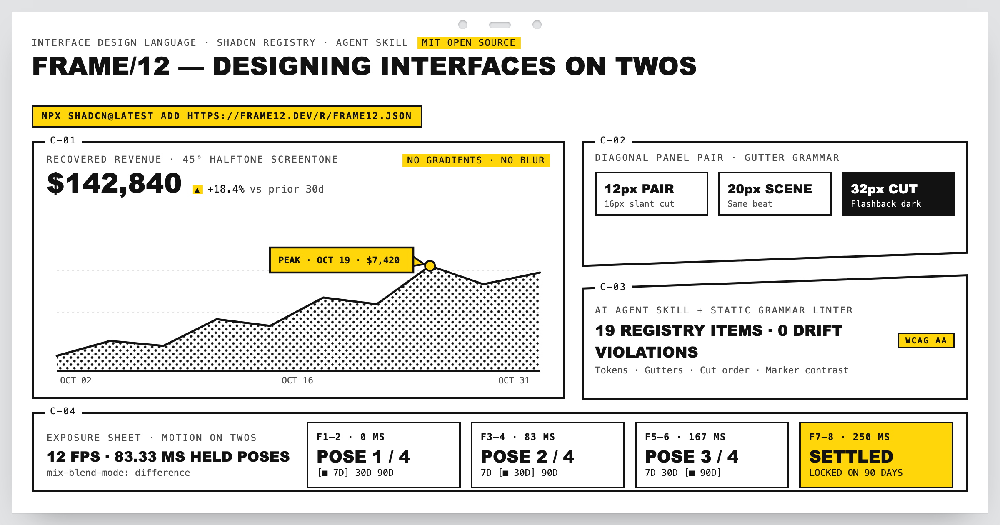
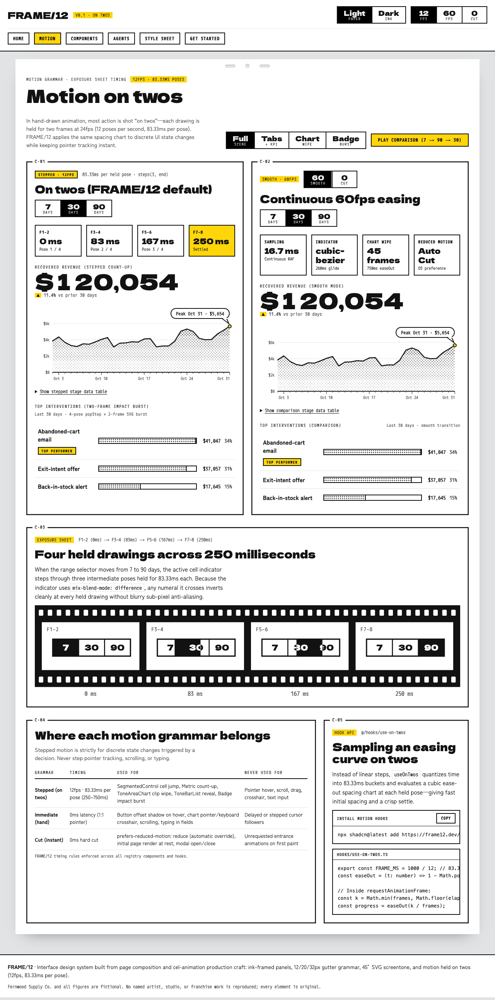
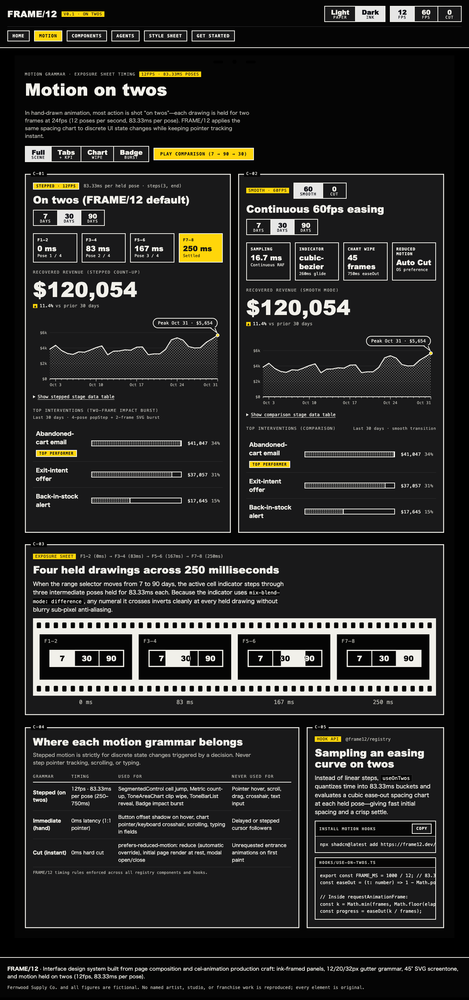

# FRAME/12

[](https://github.com/lbrodie11/frame12/releases/tag/v0.1.0)
[](registry/)
[](https://frame12.dev/components)
[](LICENSE)

**A React design system that makes interfaces look like comic pages and move like hand-drawn animation.**

Build expressive dashboards, developer tools, and editorial interfaces with ink-framed panels, screentone charts, deliberate `12fps` motion ("on twos"), and a visual grammar that both humans and AI coding agents can follow consistently.

**[Live Demo → frame12.dev](https://frame12.dev)** · **[Motion on Twos Studio](https://frame12.dev/motion)** · **[Components (19)](https://frame12.dev/components)** · **[AI Agent Skill & Linter](https://frame12.dev/agents)** · **[Get Started Guide](https://frame12.dev/get-started)**



---

## Why FRAME/12?

- **Built for products that want a distinct point of view:** Ideal for developer tools, analytics dashboards, and editorial apps tired of interchangeable rounded-card, soft-gradient templates.
- **Deliberate motion ("on twos"):** In hand-drawn animation, most action is shot on twos—each drawing is held for two frames at `24fps` (`12fps`, `83.33ms` per pose). FRAME/12 applies that same spacing chart to discrete UI state changes while keeping pointer tracking, scrolling, and typing instant (`0ms`).
- **Engineered for AI coding agents:** Instead of vague aesthetic prompts, FRAME/12 ships a portable Agent Skill (`SKILL.md`) paired with a static grammar linter (`scripts/check-frame12.mjs`) so coding agents produce consistent layouts without visual drift.

| Paper Light (`data-theme="light"`) | Flashback Dark (`data-theme="dark"`) |
| --- | --- |
| [](https://frame12.dev/motion) | [](https://frame12.dev/motion) |

---

## Install FRAME/12

### Requirements & Compatibility

- **React & Next.js:** Tested on React `18.x` and type-checked/verified for React `19.x` (`element.props.ref` compatible) in Next.js `14+` App Router projects.
- **Project setup:** An initialized `shadcn` project (`components.json` with a `@/*` path alias). Or start from a pre-configured repo in [`templates/next-starter/`](templates/next-starter/).
- **Styling:** Works standalone via scoped `.f12-*` CSS custom properties (`styles/frame12.css`). Tailwind CSS is optional (`styles/frame12-tailwind.css` is included if you want Tailwind v4 utility classes).
- **Status:** `v0.1.0` (experimental initial release covering 14 core layout/data/control components and 5 accessible primitive adapters).

### 1. Add the registry kit

Run the `shadcn` CLI from your project root to copy the components (`components/frame12/`), motion hooks (`hooks/use-on-twos.ts`), and stylesheet (`styles/frame12.css`) into your repo:

```bash
npx shadcn@latest add https://frame12.dev/r/frame12.json
```

<details>
<summary><strong>Install individual components instead of the full bundle</strong></summary>

Every component manifest at `https://frame12.dev/r/<name>.json` is self-contained and automatically includes `frame12.css` and any required hooks or Radix primitives:

```bash
npx shadcn@latest add https://frame12.dev/r/sheet.json
npx shadcn@latest add https://frame12.dev/r/scene.json
npx shadcn@latest add https://frame12.dev/r/panel.json
npx shadcn@latest add https://frame12.dev/r/panel-pair.json
npx shadcn@latest add https://frame12.dev/r/segmented-control.json
npx shadcn@latest add https://frame12.dev/r/metric.json
npx shadcn@latest add https://frame12.dev/r/tone-area-chart.json
npx shadcn@latest add https://frame12.dev/r/dialog.json
npx shadcn@latest add https://frame12.dev/r/select.json
```

Browse all 19 components and 22 registry payloads at **[frame12.dev/components](https://frame12.dev/components)**.
</details>

### 2. Import the stylesheet and fonts (`app/layout.tsx`)

Import `@/styles/frame12.css` and bind `--font-f-display` (`Dela Gothic One`), `--font-f-body` (`Zen Kaku Gothic New`), and `--font-f-mono` (`M PLUS 1 Code`):

```tsx
import { Dela_Gothic_One, Zen_Kaku_Gothic_New, M_PLUS_1_Code } from 'next/font/google';
import '@/styles/frame12.css';

const display = Dela_Gothic_One({ weight: '400', subsets: ['latin'], variable: '--font-f-display' });
const body = Zen_Kaku_Gothic_New({ weight: ['400', '500', '700'], subsets: ['latin'], variable: '--font-f-body' });
const mono = M_PLUS_1_Code({
  weight: ['400', '500', '700'],
  subsets: ['latin'],
  variable: '--font-f-mono',
  adjustFontFallback: false,
  fallback: ['ui-monospace', 'SFMono-Regular', 'Menlo', 'monospace'],
});

export default function RootLayout({ children }: { children: React.ReactNode }) {
  return (
    <html lang="en" className={`${display.variable} ${body.variable} ${mono.variable}`}>
      <body>{children}</body>
    </html>
  );
}
```

### 3. Compose a `<Sheet>` → `<Scene>` → `<Panel>` (`app/page.tsx`)

```tsx
import { Sheet, Scene, Panel, PanelPair, Metric, ToneAreaChart, Tag } from '@/components/frame12';

const REVENUE_DAYS = [
  { label: 'May 01', value: 3820 },
  { label: 'May 08', value: 4410 },
  { label: 'May 15', value: 5420 },
  { label: 'May 22', value: 4980 },
];

export default function DashboardPage() {
  return (
    <Sheet pegs motion="stepped">
      <header className="f12-hd">
        <div>
          <p className="f12-eyebrow">Checkout Recovery <Tag>30 Days</Tag></p>
          <h1 className="f12-title">Recovered Revenue</h1>
        </div>
      </header>

      <Scene gutter="scene" layout="split">
        <Panel cut="C-01" label="Primary revenue chart">
          <Metric label="Recovered revenue" value={142840} delta={0.184} deltaKind="pct" range={30} big />
          <ToneAreaChart data={REVENUE_DAYS} seriesLabel="Recovered ($)" height={220} />
        </Panel>

        <PanelPair
          top={{
            cut: 'C-02',
            label: 'Incremental profit',
            children: <Metric label="Incremental profit" value={54280} delta={0.142} deltaKind="pct" range={30} />,
          }}
          bottom={{
            cut: 'C-03',
            label: 'Conversion lift',
            children: <Metric label="Conversion lift" value={0.55} delta={0.08} deltaKind="pp" range={30} />,
          }}
        />
      </Scene>
    </Sheet>
  );
}
```

For full setup details (including dark-mode toggle persistence and Tailwind v4 configuration), see **[frame12.dev/get-started](https://frame12.dev/get-started)**.

---

## For AI Coding Agents (`SKILL.md` & Linter)

Install the portable agent skill for Claude Code, Cursor, and compatible coding agents:

```bash
npx skills add lbrodie11/frame12 --skill frame12
```

To verify that generated screens follow the design grammar with zero drift, run the static checker (`scripts/check-frame12.mjs`) or wire in the ESLint flat config (`skills/frame12/eslint.frame12.mjs`):

```bash
node scripts/check-frame12.mjs src
```

---

## The 8 Design Rules (and How Each Is Verified)

FRAME/12 replaces subjective styling feedback with eight explicit rules—**five enforced statically by `scripts/check-frame12.mjs`** and **three verified by runtime hooks, Playwright accessibility checks, and architecture constraints**:

### Statically Enforced by `scripts/check-frame12.mjs`

1. **Tokens, not literals (`color-literal`):** No hard-coded hex/RGB/HSL colors or font stacks in component or screen files. Every surface, border, and text style uses `var(--f-*)` and `var(--font-f-*)`.
2. **Semantic gutter grammar (`illegal-gutter`):** Layout spacing between panels uses three narrative gutters so distance carries meaning:
   - `12px` (`--f-gutter-pair` / `gutter="pair"`): tightly paired panels (`PanelPair`) across a `16px` diagonal slant.
   - `20px` (`--f-gutter-scene` / `gutter="scene"`): panels within the same scene.
   - `32px` (`--f-gutter-change` / `gutter="change"`): separation between scenes down the sheet.
3. **Sequential cut numbers (`cut-order`):** Panels (`C-01`, `C-02`, `C-03`…) are numbered sequentially in DOM and reading order starting at `C-01`.
4. **Marker-yellow discipline (`marker-misuse`):** Highlighter yellow (`--f-marker`, `#ffd60a`) is used strictly as a highlight surface paired with `--f-marker-ink` (`#121212`) text or as an inked peak dot with a `2px` `--f-rule` stroke—never as raw text on a white sheet.
5. **Adapter boundary (`raw-shadcn-import`):** Screens import primitives from `@/components/frame12` rather than bypassing the design language with unstyled third-party UI kits.

### Verified by Runtime Hooks, Playwright Tests (`npm test`), and Conventions

6. **Motion on twos (`useOnTwos`):** Discrete state transitions hold each pose for `83.33ms` (`12fps`). Pointer hover, scrolling, typing, and chart crosshairs stay immediate (`0ms`). `prefers-reduced-motion: reduce` switches transitions to instant cuts (`0ms`).
7. **Flashback dark mode & WCAG AA accessibility:** Dark mode flips the sheet gutters pitch black (`#050505`) while keeping panels elevated (`#19191a`). Verified by automated Playwright + `@axe-core/playwright` audits for WCAG AA contrast, visible `:focus-visible` outlines, keyboard chart navigation, and semantic `<table>` fallbacks.
8. **Minimal dependencies & craft originality:** Zero external animation or charting libraries—charts, screentone patterns, and stepped animations are built with React, SVG, and CSS. Accessible menu and select primitives use `@radix-ui/react-dropdown-menu` and `@radix-ui/react-select` (while `Dialog` uses native `<dialog>`). The system is inspired by print and cel-animation production craft rather than copied from any named work.

---

## Contributing & Monorepo Structure

```bash
npm install
npx playwright install chromium   # first time only, for automated browser verification
npm run build                     # builds lab, registry, eval, site, and templates/next-starter
npm run lint:frame12              # runs static design-grammar checker across all workspaces
npm test                          # runs sync checks, static linter, and Playwright a11y/functional suites
```

- Run the documentation site locally: `npm --workspace=@frame12/site run dev`
- Run the standalone Next.js starter template: `npm --prefix templates/next-starter run dev`
- Verify registry JSON placement and React 18/19 type-checking: `node scripts/smoke-install.mjs`

| Workspace / Directory | Contents |
| --- | --- |
| [`registry/`](registry/) | Source for the 22 `shadcn`-compatible registry payloads (`registry/ui/`, `registry/hooks/use-on-twos.ts`, `registry/styles/frame12.css`), built into `site/public/r/*.json`. |
| [`skills/frame12/`](skills/frame12/) | Portable AI Agent Skill (`SKILL.md`, `references/components-and-adapters.md`, `references/examples-and-mistakes.md`) and ESLint flat config (`eslint.frame12.mjs`). |
| [`site/`](site/) | Next.js App Router documentation and interactive showcase deployed at **[frame12.dev](https://frame12.dev)**. |
| [`templates/next-starter/`](templates/next-starter/) | Standalone Next.js App Router + TypeScript starter template pre-configured with local WOFF2 fonts (`next/font/local`), `.claude/skills/frame12/SKILL.md`, and `scripts/check-frame12.mjs`. |
| [`eval/`](eval/) | AI reproduction benchmark across 3 product archetypes (`01-settings`, `02-landing-hero`, `03-data-table`), static linter tests (`check-linter.mjs`), and Playwright WCAG AA + mobile verification ([`eval/RESULTS.md`](eval/RESULTS.md)). |
| [`lab/`](lab/) | Phase 1 recovery dashboard prototype (`prototype.html`), interactive A/B comparison harness (`study.html`), and interactive style sheet (`style-sheet.html`). |

---

## Fonts & License

All typefaces used in FRAME/12 (`Dela Gothic One`, `Zen Kaku Gothic New`, and `M PLUS 1 Code`), as well as `Geist` and `Geist Mono` (used in the Phase 1 comparison baseline only), are open-source under the [SIL Open Font License 1.1](https://openfontlicense.org/).

MIT License — see [`LICENSE`](LICENSE). Copyright (c) 2026 Laqwan Brodie.
